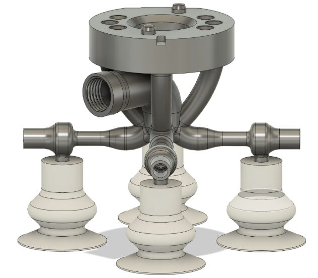
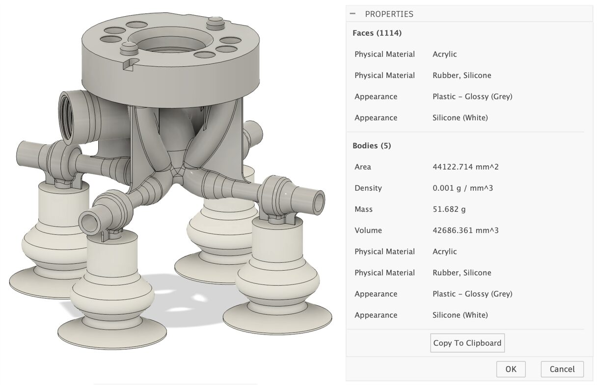

# Additively Manufactured Pneumatic Vacuum Gripper

**Advanced Design for Additive Manufacturing (ADAM) · TH Rosenheim · 2026**
Team: Abdul Vadud Pathan, Agney Jadav · Supervisors: Prof. Dr.-Ing. Fabian Riß, M.Eng. Nicolas Rolinck

[English](#english) · [Deutsch](#deutsch)

---

## English

### The task
Design a lightweight vacuum gripper for robots that is made in one additive build, with integrated Venturi nozzles that generate suction from compressed air, and mounts on a Schunk SWA 005 adapter.

| Requirement | Target | Achieved |
|---|---|---|
| Mass | ≤ 100 g | **51.7 g** |
| Envelope | 100 × 100 × 80 mm | 77.3 × 77.3 × 78.1 mm |
| Cost | ≤ 300 € | **72.80 €** |
| Suction per cup (plate held vertically, 10 m/s² acceleration) | 21,000 Pa needed | **42,219 Pa** available |
| Max. stress in VeroClear (limit 50 MPa) | – | ~17 MPa |

### What we did
- Followed a structured design process: requirements list, functional analysis, weighted concept evaluation, AM suitability check
- **Material and process selection**: Stratasys Objet260 Connex3 (PolyJet), rigid VeroClear body and rubber-like TangoBlack suction cups printed in one job
- **Channel design**: iterated the Venturi nozzle geometry; moving from one to four Venturis raised the suction at the cups from −1,789 Pa to −18,371 Pa in CFD
- **FEM and topology optimisation** in ANSYS, organic support-free geometry, build orientation chosen to avoid supports
- **Cost model** for each design review (machine time, material, post-processing, tooling)

### Skills shown
`DfAM` `PolyJet` `multi-material printing` `pneumatics` `Venturi design` `CFD` `ANSYS FEM` `topology optimisation` `Fusion 360` `cost estimation` `design reviews`

---

## Deutsch

### Aufgabe
Ein leichter Vakuumgreifer für Roboter, gefertigt in einem additiven Bauprozess, mit integrierten Venturi-Düsen und Anbindung an einen Schunk-SWA-005-Adapter.

### Ergebnis
- **51,7 g** statt max. 100 g, **72,80 €** statt max. 300 €
- 42.219 Pa verfügbarer Unterdruck je Saugnapf bei 21.000 Pa Bedarf
- Max. Spannung ca. 17 MPa (Grenze VeroClear 50 MPa)
- PolyJet-Mehrmaterialdruck: starrer Grundkörper (VeroClear) und flexible Saugnäpfe (TangoBlack) in einem Druck
- Vier statt einer Venturi-Düse: Unterdruck an den Saugnäpfen von −1.789 Pa auf −18.371 Pa gesteigert
- FEM, Topologieoptimierung und Kostenkalkulation in jeder Design-Review-Phase
